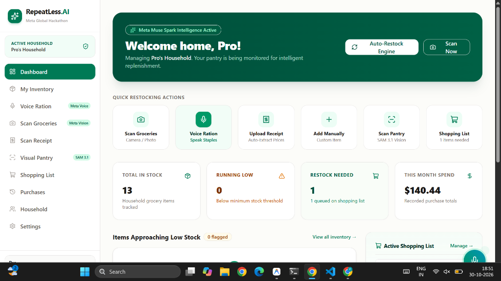
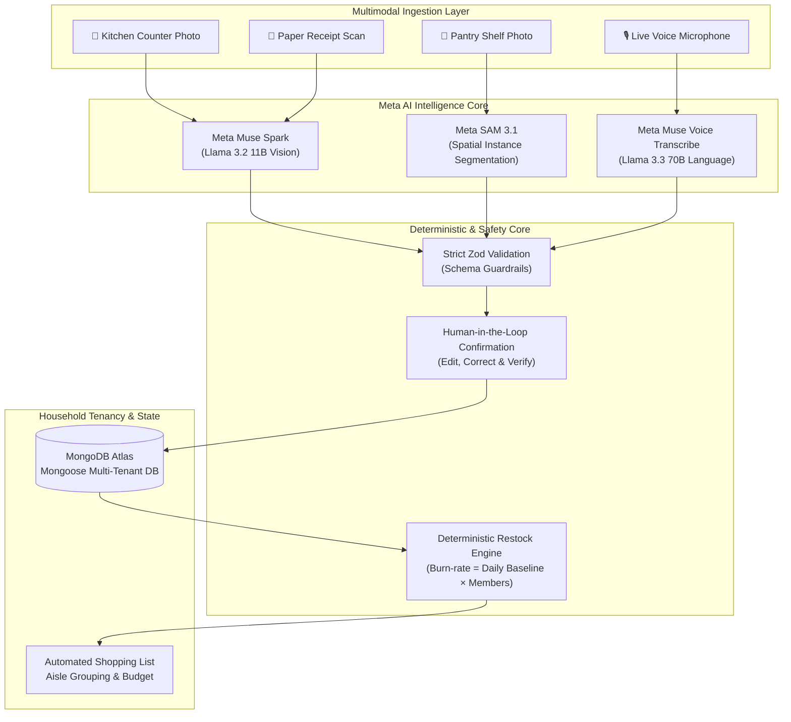

<div align="center">

# 🌿 RepeatLess AI
### *Autonomous Household Grocery & Restocking Intelligence*

[](LICENSE)
[](https://nextjs.org/)
[](https://www.typescriptlang.org/)
[](https://ai.meta.com/)
[](https://tailwindcss.com/)
[](https://www.mongodb.com/atlas)
[](https://meta-one-delta.vercel.app)
[](tests/unit/core-logic.test.ts)

<br/>

> **Built for the Meta Global AI Developer Hackathon**  
> *"Your Home Knows What It Needs."*

<p align="center">
  <a href="https://meta-one-delta.vercel.app"><b>🌐 Live Production Web App</b></a> •
  <a href="#-quick-tour--live-dashboard"><b>Explore Preview</b></a> •
  <a href="#-interactive-architecture-blueprint"><b>System Flow</b></a> •
  <a href="#-meta-ai-multimodal-trio"><b>Meta AI Models</b></a> •
  <a href="#-deterministic-restocking-engine"><b>Math Engine</b></a> •
  <a href="#-quickstart--local-setup"><b>Quickstart</b></a> •
  <a href="#-mit-license"><b>MIT License</b></a>
</p>

---

<!-- Visual Showcase Mockup -->
<div align="center">
  
</div>

<p align="center">
  <sub>⚡ <b>Live RepeatLess AI Household Command Center</b> — Real-time pantry tracking, voice ration microphone, deterministic replenishment predictions, and automatic supermarket shopping cart generation.</sub>
</p>

</div>

---

## 🌟 What is RepeatLess AI?

**RepeatLess AI** is a production-grade, AI-first household grocery inventory tracking and autonomous restocking intelligence system. It eradicates manual pantry tracking, prevents duplicate grocery purchases, curbs household food waste, and prepares personalized shopping lists automatically using **Meta Multimodal AI**.

### The Core Paradigm

```
┌────────────────────┐     ┌──────────────────────┐     ┌───────────────────────┐
│  Capture Groceries │ ──> │ Understand Products  │ ──> │   Update Inventory    │
│  Camera / Receipt  │     │ Meta Muse Spark Vision│    │ Household Data Store  │
└────────────────────┘     └──────────────────────┘     └───────────────────────┘
                                                                   │
                                                                   ▼
┌────────────────────┐     ┌──────────────────────┐     ┌───────────────────────┐
│ Auto Shopping List │ <── │  Predict Restocking  │ <── │ Deterministic Engine  │
│ Categorized Budget │     │ Burn-Rate Algorithms │     │ Safe Calculations     │
└────────────────────┘     └──────────────────────┘     └───────────────────────┘
```

---

## 🎯 Key Features at a Glance

| Feature | Powered By | Description |
|---|---|---|
| **📸 Counter Grocery Vision** | **Meta Muse Spark** (`llama-3.2-11b-vision`) | Instantly parses groceries on countertops, extracting brand names, packaging sizes, quantities, and categories. |
| **🧾 Supermarket Receipt OCR** | **Meta Muse Spark Document OCR** | Ingests supermarket checkout slips, breaks down line items, captures unit costs, and populates the household expenditure ledger. |
| **🎙️ Voice Ration Microphone** | **Meta Muse Voice** + Web Speech | Hands-free spoken input (*"I bought 2 litres of milk, 1 pack of eggs, and 5 kg of rice"*), parses quantities & updates pantry stock. |
| **🔍 SAM 3.1 Pantry Intelligence** | **Meta SAM 3.1** Spatial Segmentation | Segments multi-shelf cupboards, isolates distinct packaging bounding boxes, and flags opaque canisters for physical check. |
| **📊 Deterministic Restock Engine** | Mathematical Formulas | Transparent, zero-hallucination inventory depletion tracking based on household size and historical purchase velocity. |
| **🛒 Auto Shopping Checklist** | Dynamic Restock Queue | Automatically prioritizes low-stock and out-of-stock items, groups them by supermarket aisle, and tallies projected budget. |
| **🛡️ Multi-Household Isolation** | Zero-Trust Database Tenancy | Full multi-tenant data isolation with cryptographically secure session cookies, rate-limiting, and member invitation tokens. |

---

## 🏗️ Interactive Architecture Blueprint

### Multimodal Restocking Pipeline



---

## 🔬 Meta AI Multimodal Trio

<details>
<summary><b>🔍 1. Meta Muse Spark (Vision & Document OCR) — Click to expand</b></summary>

<br/>

**Model**: `meta/llama-3.2-11b-vision-instruct` via GitHub Models / Azure Inference API.

- **Counter Vision**: Accurately detects visible produce, packaged groceries, and dairy without guessing invisible contents.
- **Strict Brand Extraction**: Only records brand names when clearly printed on labels; flags generic or unbranded items as `null`.
- **Receipt Parsing**: Translates raw checkout receipts into structured line items with purchase dates, store names, individual unit prices, and overall totals.

```json
{
  "items": [
    {
      "name": "Whole Milk",
      "brand": "Organic Valley",
      "category": "Dairy",
      "quantity": 2,
      "unit": "litres",
      "confidence": 0.96
    }
  ]
}
```
</details>

<details>
<summary><b>🥫 2. Meta SAM 3.1 (Segment Anything Model) — Click to expand</b></summary>

<br/>

**Model**: `meta/sam-3.1` Spatial Segmentation Engine.

- **Shelf Object Isolation**: Generates normalized bounding box coordinates `[ymin, xmin, ymax, xmax]` for each item resting on refrigerator and pantry shelves.
- **Opaque Packaging Detection**: Distinguishes between translucent packaging and opaque canisters (e.g., steel containers, ceramic olive oil jars), prompting the user with a `Manual Check Needed` badge.
- **Duplicate Cluster Prevention**: Cross-references detected bounding boxes against existing stock to prevent duplicate pantry entries.
</details>

<details>
<summary><b>🎙️ 3. Meta Muse Voice Transcribe & Microphone UI — Click to expand</b></summary>

<br/>

**Model**: `meta/llama-3.3-70b-instruct` + Web Audio API.

- **Interactive Microphone**: Real-time microphone listening interface featuring animated glowing indicators, dynamic color pulses, and speech transcription.
- **Natural Language Ration Parsing**: Extracts compound grocery declarations like:
  > *"We used half a litre of olive oil and bought 3 packs of whole wheat pasta and two dozen eggs."*
- Resolves operations into exact `add`, `consume`, or `set` actions for the inventory database.
</details>

---

## 📐 Deterministic Restocking Engine

RepeatLess AI deliberately avoids using probabilistic generative models for mission-critical pantry math. Instead, it relies on strict, verified algorithms:

$$\text{Daily Consumption Rate} = \text{Category Baseline} \times \text{Household Size}$$

$$\text{Estimated Days Remaining} = \left\lfloor \frac{\text{Current Quantity}}{\text{Daily Consumption Rate}} \right\rfloor$$

$$\text{Suggested Restock Quantity} = \max\left(1, (\text{Minimum Threshold} \times 2) - \text{Current Quantity}\right)$$

### Stock Status Matrix
| Condition | Stock Status | System Action |
|---|---|---|
| $\text{Current Quantity} = 0$ | 🔴 **Critical (Out of Stock)** | Immediately enqueued at top of Shopping List with urgent badge |
| $\text{Current Quantity} \le \text{Threshold}$ | 🟡 **Running Low** | Added to Active Shopping List with calculated replenishment quantity |
| $\text{Current Quantity} \le 1.25 \times \text{Threshold}$ | 🟠 **Approaching Low** | Displayed in dashboard warnings; scheduled for next grocery run |
| $\text{Current Quantity} > 1.25 \times \text{Threshold}$ | 🟢 **Healthy Stock** | Monitored according to burn-rate schedule |

---

## ⚡ Interactive Feature Demos

<details>
<summary><b>📱 1. Live Household Dashboard Walkthrough</b></summary>

<br/>

The unified command center gives households real-time visibility into their kitchen:
- **Hero Alert Banner**: Live indicator confirming Meta Muse Spark intelligence connectivity.
- **Quick Action Bar**: One-click navigation to Camera Counter Scan, Voice Ration, Receipt OCR, and SAM 3.1 Pantry.
- **Household Health Cards**: Total in stock, running low counter, restock queue size, and recorded monthly spend metrics.
- **Low Stock Radar**: Proactive alerts before essential staples run out completely.
- **Active Shopping List Drawer**: One-click toggle to mark items as purchased and sync back to inventory.
</details>

<details>
<summary><b>🎙️ 2. Voice-Based Grocery Ingestion</b></summary>

<br/>

1. Click the **Voice Ration** button in the dashboard or sidebar.
2. Tap the pulsating **Microphone Icon** to activate speech recognition.
3. Speak naturally: *"We bought 5 kg of basmati rice, 2 bottles of avocado oil, and 1 pack of cheddar cheese."*
4. Tap **Parse with Meta Voice AI**.
5. Inspect the extracted item cards, edit quantities if needed, and confirm additions with one click.
</details>

<details>
<summary><b>🧾 3. Supermarket Receipt Ingestion & Ledger</b></summary>

<br/>

1. Navigate to **Scan Receipt** and drop any checkout receipt image.
2. Meta Muse Spark extracts the merchant name, date, and individual itemized prices.
3. Review extracted line items side-by-side with receipt preview.
4. Saving automatically logs the financial transaction in the **Purchases Ledger** and updates inventory quantities.
</details>

---

## 🚀 Quickstart & Local Setup

### Prerequisites
- **Node.js**: v18.18+ or v20+
- **npm** or **pnpm**
- **MongoDB Atlas** cluster (or local MongoDB 6+)

### 1. Clone the Repository
```bash
git clone https://github.com/your-username/repeatless-ai.git
cd repeatless-ai
```

### 2. Install Dependencies
```bash
npm install
```

### 3. Setup Environment Variables
Create `.env.local` based on `.env.example`:
```bash
cp .env.example .env.local
```

Fill in your configuration:
```env
# MongoDB Atlas
MONGODB_URI=mongodb+srv://<username>:<password>@cluster0.mongodb.net/repeatless?retryWrites=true&w=majority

# Authentication Secret (Generate with: openssl rand -base64 32)
AUTH_SECRET=your_super_secret_session_encryption_key_at_least_32_chars
AUTH_URL=http://localhost:3000
NEXT_PUBLIC_APP_URL=http://localhost:3000

# Meta Multimodal AI (GitHub Models / Azure AI Inference)
META_API_KEY=your_github_token_or_azure_inference_key
META_API_ENDPOINT=https://models.inference.ai.azure.com
META_VISION_MODEL=meta/llama-3.2-11b-vision-instruct
META_TEXT_MODEL=meta/llama-3.3-70b-instruct
```

> **💡 Zero-Config Perception Fallback**:  
> If no `META_API_KEY` is provided, RepeatLess AI runs in **Resilient Safe Perception Mode** using realistic internal heuristics, allowing hackathon judges to immediately test all camera, receipt, voice, and pantry workflows out of the box!

### 4. Run Test Suite
```bash
npm test
```
```
✓ tests/unit/core-logic.test.ts (11 tests passed)
  ✓ calculateStockStatus: identifies healthy, low, and critical stock
  ✓ calculateRestockSuggestion: computes deterministic quantities
  ✓ Zod Schemas: verifies inventory, auth, and AI response validations
  ✓ RateLimiter: protects against brute-force attacks
```

### 5. Launch the Application
```bash
npm run dev
```
Open **[http://localhost:3000](http://localhost:3000)** in your browser.

---

## 📁 Repository Structure

```
repeatless-ai/
├── public/
│   ├── images/
│   │   ├── dashboard-preview.png   # Production dashboard screenshot
│   │   ├── sample-groceries.svg    # Demo counter photo asset
│   │   ├── sample-receipt.svg      # Demo supermarket receipt asset
│   │   └── sample-pantry.svg       # Demo pantry shelf asset
│   ├── logo.svg                    # Brand vector logo
│   └── logo-icon.svg               # Brand icon
├── src/
│   ├── app/
│   │   ├── (marketing)/page.tsx    # High-converting landing page
│   │   ├── (auth)/                 # Login, Register, Forgot/Reset Password
│   │   ├── (dashboard)/            # Dashboard, Inventory, Vision, Voice, Receipts, etc.
│   │   └── api/                    # 34 Server-Side Route Handlers
│   ├── components/ui/              # Polished UI primitive components
│   ├── lib/
│   │   ├── ai/                     # Meta Muse Spark & SAM 3.1 AI adapters
│   │   ├── inventory/              # Restock calculation & burn-rate engine
│   │   ├── security/               # Password hashing, JWT sessions, rate limiter
│   │   ├── validations/            # Strict Zod schemas
│   │   └── db.ts                   # MongoDB connection singleton
│   ├── models/                     # Mongoose database models
│   └── types/                      # TypeScript definitions
├── tests/
│   └── unit/core-logic.test.ts     # Automated unit test suite
├── LICENSE                         # Official MIT License
├── package.json
└── tsconfig.json
```

---

## 🛡️ Security & Privacy Engineering

- **No Plain-text Passwords**: Uses bcrypt with 12 salt rounds for credential protection.
- **Zero-Trust Multi-Tenancy**: Every database query explicitly checks `userId` or `householdId`.
- **HTTP-Only Cookies**: Session tokens are encrypted in secure `SameSite=Lax` cookies, immune to JavaScript XSS theft.
- **Brute-Force Rate Limiting**: In-memory sliding window limiter guards authentication and expensive AI endpoints.
- **Input Sanitization**: 100% of incoming payloads and model outputs pass strict Zod schema validation.

---

## ☁️ Production Deployment on Vercel

1. Fork or push this repository to GitHub.
2. Import the project into [Vercel](https://vercel.com).
3. Set the environment variables (`MONGODB_URI`, `AUTH_SECRET`, `META_API_KEY`).
4. Click **Deploy** — Turbopack compiles all 34 routes in seconds.

---

## 📄 MIT License

This project is open-source software licensed under the **[MIT License](LICENSE)**.

```
MIT License

Copyright (c) 2026 RepeatLess AI Contributors

Permission is hereby granted, free of charge, to any person obtaining a copy
of this software and associated documentation files (the "Software"), to deal
in the Software without restriction, including without limitation the rights
to use, copy, modify, merge, publish, distribute, sublicense, and/or sell
copies of the Software, and to permit persons to whom the Software is
furnished to do so, subject to the following conditions:

The above copyright notice and this permission notice shall be included in all
copies or substantial portions of the Software.
```

---

<div align="center">
  <sub>Built with ❤️ for the <b>Meta Global AI Developer Hackathon</b></sub>
</div>
